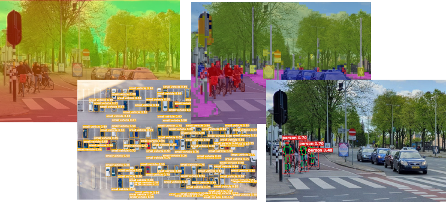
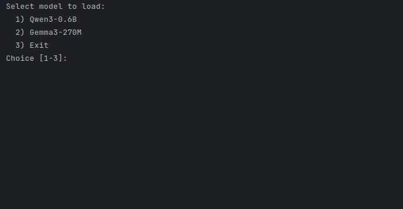

[](http://www.apache.org/licenses/LICENSE-2.0)
[](https://bell-sw.com/pages/downloads/)
[](https://maven.apache.org/)
[](http://search.maven.org/#artifactdetails|com.igormaznitsa|nano-vllm-java|1.5.0|jar)
[](https://www.arthursacresanimalsanctuary.org/donate)

# Nano-vLLM Java

**1.5.0** is a Java library that loads a model you already have and runs it on the CPU. The call stays in the JVM: no Python process, no CUDA, and no PyTorch. It does not train models.

Use it when a Java application needs a short chat reply, a sentence vector, a transcript, a spoken WAV, a language label, a picture read, a choice with a probability, or a reply that can call your own Java function.

**Supports** Qwen3, Qwen3.5 text, Gemma 3, Gemma 4 text, Llama, LFM2, BERT embeddings, EmbeddingGemma, Whisper, Piper, fastText, and YOLO26 images. The full list is [below](#supported-models).

**Attach** `com.igormaznitsa:nano-vllm-java:1.5.0` on JDK 21+. Coordinates and a first call are under [Add it](#add-it).

**Try a sample** after one download. Qwen3-0.6B needs no Hugging Face gate:

```bash
./models/download-qwen3-0.6b.sh
mvn -pl nano-vllm-java-samples -q exec:java
```

That opens the interactive menu. Every other sample is under [Samples](#samples). The longer design tour is [`description.md`](description.md).

Ideas here were inspired by the Python [nano-vllm](https://github.com/GeeeekExplorer/nano-vllm) educational engine.

## Contents

- [Calls](#calls)
- [Supported models](#supported-models)
- [Add it](#add-it)
- [Chat](#chat)
- [Tools](#tools)
- [Jev](#jev)
- [Images](#images)
- [Search, speech, and labels](#search-speech-and-labels)
- [Samples](#samples)
- [Threads](#threads)
- [Limits](#limits)
- [Build from source](#build-from-source)

## Calls

| You have | You get | Call |
|----------|---------|------|
| A question or a log snippet | A text reply | `llm.chatOnce(…)` or `llm.chat().send(…).answer()` |
| A sentence | A vector | `generate(text, EMBEDDING)` |
| A WAV clip | A transcript | `generate(sound, TEXT)` |
| A sentence | A WAV file | `generate(text, AUDIO)` |
| A sentence | Ranked labels | `generate(text, LABELS)` |
| A picture | Boxes, a mask, pose, a map, depth, or image labels | `model.generate(image, IMAGE)` |
| A state and a fixed list of options | The chosen option and a probability for each | `jev.decide(…)` |
| Notes on disk | A reply that can quote those notes | `llm.rag(…).ask(…)` |
| A question your Java function can answer | A reply after that function runs | `builder.tool(…).build()`, then `chatOnce(…)` |

One `LLM` runs one call at a time. Share the loaded `LlmModel` when calls should overlap. The rules are in [Threads](#threads).

## Supported models

`LlmModelFactory.make(path)` accepts a Hugging Face folder, a `.gguf` file, a YOLO26 `*.onnx`, or a fastText `*.bin` / `*.ftz`.

| Family | Typical file | Job |
|--------|----------------|-----|
| Qwen3, Gemma 3, Llama | Safetensors folder, or ONNX weights in that folder | Chat |
| Qwen3 | Also a `.gguf` file | Chat |
| Qwen3.5 text | Safetensors folder, or a `.gguf` file (`qwen35`). The vision tower is skipped | Chat, tools, and Jev |
| Gemma 4 text (QAT mobile) | Safetensors only | Chat and tools |
| LFM2 | `.gguf` only | Chat and tools |
| BERT (gte, E5, XLM-RoBERTa, …) | `.gguf` or ONNX | Embeddings |
| EmbeddingGemma | Safetensors folder (`2_Dense` and `3_Dense` included) | Embeddings |
| Whisper | Safetensors folder | Speech to text |
| Piper | `*.onnx` + `*.onnx.json` | Text to speech |
| fastText | `*.bin` or `*.ftz` | Labels |
| YOLO26 (nano through extra-large) | fused `*.onnx`, `nms=False`, 640 | Detect, segment, pose, oriented boxes, semantic map, depth, or image labels |

If a folder has both safetensors and ONNX, safetensors is used. An unsupported file fails with `UnsupportedModelException` and the list of families this build knows.

Download scripts are in [`models/README.md`](models/README.md). A first chat model with no Hugging Face gate is Qwen3-0.6B (`./models/download-qwen3-0.6b.sh`). Gemma3-270M is smaller and needs the model license accepted on Hugging Face first (`./models/download-gemma3-270m.sh`).

## Add it

JDK **21+**. Gemma3-270M and Qwen3-0.6B want a few gigabytes of heap. The in-repo demos expect about 16 GB.

**Maven**

```xml
<dependency>
  <groupId>com.igormaznitsa</groupId>
  <artifactId>nano-vllm-java</artifactId>
  <version>1.5.0</version>
</dependency>
```

**Gradle**

```gradle
implementation 'com.igormaznitsa:nano-vllm-java:1.5.0'
```

On the module path: `requires com.igormaznitsa.nanollvm;`.

Weights are not in the jar. Point `LlmModelFactory` at a downloaded folder (`config.json`, tokenizer, `*.safetensors`) or at a single `.gguf` file.

## Chat

```java
import com.igormaznitsa.nanollvm.llm.LLM;
import com.igormaznitsa.nanollvm.models.LlmModel;
import com.igormaznitsa.nanollvm.models.LlmModelFactory;

import java.nio.file.Path;

Path modelDir = Path.of("/opt/models/Gemma3-270M");

try (LlmModel model = LlmModelFactory.make(modelDir);
     LLM llm = LLM.builder(model)
         .noSystemPrompt()   // Gemma chat path; Qwen can take .systemPrompt("…")
         .build()) {

  String reply = llm.chatOnce("""
      Read the log and reply in three short bullets: what failed, likely cause, one next check.
      Do not invent hosts or error codes that are not in the log.

      2026-08-07 22:14:08 ERROR payment-api - give up order=99102 after 3 timeouts upstream=billing-svc:8443
      """);
  System.out.println(reply);
}
```

The same program is `LogTriageHelloWorld` (default folder `models/Gemma3-270M`):

```bash
mvn -pl nano-vllm-java-samples -q exec:java \
  -Dexec.mainClass=com.igormaznitsa.nanollvm.samples.LogTriageHelloWorld
```

`llm.chat()` starts a transcript. `llm.chat(session)` continues one opened on that same engine. A session from another engine is rejected. `session.filter(…)` returns a `ChatAdmission` for each message: keep it in the transcript, send it to the model, both, or neither. Every filter must allow a destination. Stored messages are checked again on the next send.

Thinking is split with the checkpoint's own special tokens. A quoted `<think>`…`</think>` inside the scratchpad stays in thinking. The answer starts after the close that balances the opening tag.

## Tools

A chat turn can call a Java function registered on the engine. The model writes the call in that checkpoint's own tool format. The engine runs the function, sends the returned text back, and continues the reply. `chat` and `chatOnce` do this. Raw `generate` does not.

Qwen3, Qwen3.5, LFM2, and Gemma 4 are accepted. Gemma 3 and Llama fail at `build()` when a tool is registered.

```java
import com.igormaznitsa.nanollvm.llm.LLM;
import com.igormaznitsa.nanollvm.llm.ModelTool;
import com.igormaznitsa.nanollvm.models.LlmModel;
import com.igormaznitsa.nanollvm.models.LlmModelFactory;

import java.nio.file.Path;

ModelTool osName = ModelTool.of(
    "os_name",
    "Operating system name of this machine.",
    "{\"type\":\"object\",\"properties\":{}}",
    arguments -> System.getProperty("os.name"));

try (LlmModel model = LlmModelFactory.make(Path.of("/opt/models/Qwen3-0.6B"));
     LLM llm = LLM.builder(model).tool(osName).build()) {

  System.out.println(llm.chatOnce("What operating system is this? Call os_name."));
}
```

The function receives a JSON object (`{}` when the call has no arguments) and returns text. The third argument is a JSON Schema object. A name matches `[A-Za-z_][A-Za-z0-9_]*`. A space the model wrote inside the name is ignored, so `os_ name` still matches `os_name`. One user message runs at most `maxToolExecutions` calls (four when omitted). The function runs on the chat thread. A thrown exception goes back as `error: …` and the turn continues.

`ToolsHelloWorld` asks Qwen3-0.6B for the OS name, then for a directory listing, each in its own turn.

```bash
mvn -pl nano-vllm-java-samples -q exec:java \
  -Dexec.mainClass=com.igormaznitsa.nanollvm.samples.ToolsHelloWorld
```

## Jev

A decision is a typed question: a choice, a yes/no, or a score. The engine reads the next-token probability of a few labels (`A` / `B`, `Yes` / `No`, or `1` / `2`) and returns the option with the highest probability, plus a probability for each option.

`LLM.builder(model).toJev()` is the call for every causal chat checkpoint, including Jeff-Qwen3.5-0.8B. There is no second API for Jeff's readout head. Embeddings, Whisper, Piper, fastText, and YOLO are refused. `Jev.close()` closes the engine and leaves the model open.

The default readout is `L0`: a choice is read once per option, a yes/no is read as both phrasings, and those probabilities are averaged. After eight states of the same question, a label prior from those states is applied. `jevLevel(JevLevel.RAW)` is one prefill in the order you passed.

```java
import com.igormaznitsa.nanollvm.jev.Jev;
import com.igormaznitsa.nanollvm.jev.JevDecision;
import com.igormaznitsa.nanollvm.jev.JevQuestion;
import com.igormaznitsa.nanollvm.llm.LLM;
import com.igormaznitsa.nanollvm.models.LlmModel;
import com.igormaznitsa.nanollvm.models.LlmModelFactory;

import java.nio.file.Path;
import java.util.List;

try (LlmModel model = LlmModelFactory.make(Path.of("models/Gemma3-270M"));
     Jev jev = LLM.builder(model).toJev()) {

  JevDecision route = jev.decide(
      "My card was charged twice for one order.",
      JevQuestion.choice("Which team should handle this?",
          List.of("billing", "technical", "sales", "other")));
  System.out.println(route.answer() + " " + route.probability("billing"));

  JevDecision refund = jev.decide(
      "I want my money back for order 441.",
      JevQuestion.yesNo("Does this message ask for a refund?"));
  System.out.println(refund.answer());

  JevDecision urgency = jev.decide(
      "The payment page returns 500 and the customer cannot check out.",
      JevQuestion.score("How urgent is the customer's request?",
          List.of("low", "medium", "high")));
  System.out.println(urgency.score().getAsDouble());
}
```

Jeff uses the same call. Russian checkers passes `jevLevel(JevLevel.RAW)` because a turn can have many legal moves:

```java
import com.igormaznitsa.nanollvm.jev.JevLevel;

try (LlmModel model = LlmModelFactory.make(Path.of("models/Jeff-Qwen3.5-0.8B"));
     Jev jev = LLM.builder(model).jevLevel(JevLevel.RAW).toJev()) {
  JevDecision route = jev.decide(state, question);
}
```

Download Jeff with `./models/download-jeff-qwen3.5-0.8b.sh`. `JevHelloWorld` prints a choice at L0 and at RAW, a yes/no, a score, then eight states until the prior turns on.

```bash
mvn -pl nano-vllm-java-samples -q exec:java \
  -Dexec.mainClass=com.igormaznitsa.nanollvm.samples.JevHelloWorld
```

## Images

A picture goes in as packed pixels. The file decides the job: objects, a mask, pose points, oriented boxes, a semantic map, depth, or image labels. Pictures are `ArgbImage` (row-major `0xAARRGGBB`). The library has no `java.desktop` dependency. `YoloStreetHelloWorld.fromBufferedImage` copies a `BufferedImage` into that layout.



*Depth tints the street from red (near) to green (far). Semantic paints each surface. Oriented boxes mark the parking lot. Detect writes the person scores on the crossing.*

The same call loads `yolo26n.onnx` through `yolo26x.onnx`. The first convolution selects the scale: 16 channels is nano, 32 is small, 64 is medium or large, and 96 is extra-large. A second copy of the first block selects large when the stem is 64. The file is a fused export (`nms=False`, image size 640). P2, P6, YOLOE, and a `.pt` file are refused.

`open(path)` detects the kind. A renamed file such as `lalala.onnx` has nothing to detect, so pass `open(path, LlmModelType.YOLO_DETECT)`.

```java
import com.igormaznitsa.nanollvm.models.ArgbImage;
import com.igormaznitsa.nanollvm.models.Box;
import com.igormaznitsa.nanollvm.models.LlmInImage;
import com.igormaznitsa.nanollvm.models.LlmModality;
import com.igormaznitsa.nanollvm.models.LlmModel;
import com.igormaznitsa.nanollvm.models.LlmModelFactory;
import com.igormaznitsa.nanollvm.models.LlmOutObjects;
import com.igormaznitsa.nanollvm.models.VisionHit;

import java.nio.file.Path;
import java.util.List;

int[] pixels = /* row-major 0xAARRGGBB, index y * width + x */;

try (LlmModel model = LlmModelFactory.make(
    Path.of("models/YOLO26n/detect/yolo26n.onnx"))) {

  LlmOutObjects found = model.generate(
      LlmInImage.builder(new ArgbImage(width, height, pixels))
          .addClass("car", 0.4f)
          .addClass("bicycle", 0.3f)
          .build(),
      LlmModality.IMAGE);

  List<String> names = model.classNames();
  for (VisionHit hit : found.objects()) {
    Box box = (Box) hit.shape();
    System.out.println(names.get(hit.classId()) + " " + hit.probability()
        + " @ " + box.left() + "," + box.top());
  }
}
```

The picture is letterboxed to a square whose edge is a multiple of 32 (640 when omitted). Boxes and points come back in the original picture's pixels. `minProbability` is `0.25` and `maxDetections` is 300 when omitted. `addClass("car", 0.4f)` uses that floor for one line of `classes.txt` and leaves every other class on `minProbability`. An unknown name is rejected. Pose drops a joint below `0.5`. Classification returns at most 5 labels. A knob that does not apply to the loaded head is rejected when it differs from the default. `classNames()` is `classes.txt` beside the ONNX file. Depth has no names.

| File | `generate` result |
|------|-------------------|
| `yolo26n.onnx`, `yolo26s.onnx`, and the wider detect files | `LlmOutObjects` — a `Box` per object |
| `…-seg.onnx`, `…-obb.onnx` | `LlmOutObjects` — a polygon |
| `…-pose.onnx` | `LlmOutObjects` — a box plus keypoints |
| `…-sem.onnx`, `…-depth.onnx` | `LlmOutImage` |
| `…-cls.onnx` | `LlmOutLabels` via `generate(image, LABELS)` |

```bash
./models/download-yolo26n.sh
mvn -pl nano-vllm-java-samples -q exec:java \
  -Dexec.mainClass=com.igormaznitsa.nanollvm.samples.YoloStreetHelloWorld
```

With no argument the sample asks for a head. `detect`, `seg`, `sem`, `pose`, `obb`, `depth`, or `cls` skips the menu. The marked picture is `yolo-street-<head>.png`. Point the same call at a `yolo26s`, `yolo26m`, `yolo26l`, or `yolo26x` ONNX exported the same way.

## Search, speech, and labels

Each snippet loads a model the same way as chat, then asks for a different result. `generate` returns the concrete type for that job.

**Sentence vector** — `./models/download-multilingual-e5-small.sh`. EmbeddingGemma is the same call (`./models/download-embeddinggemma-300m.sh`); you put that checkpoint's task prefix on the text. The vector is L2-normalized.

```java
LlmOutEmbedding vector = llm.generate(
    LlmInText.of("query: hello world"), LlmModality.EMBEDDING);
```

**Speech to text** — mono PCM in `[-1, 1]`, or an uncompressed WAV. `./models/download-whisper-base.sh`.

```java
LlmOutText transcript = llm.generate(
    LlmInSound.ofWav(Files.readAllBytes(Path.of("clip.wav"))), LlmModality.TEXT);
```

**Text to speech** — PCM16 WAV bytes. `./models/download-piper-en-lessac-medium.sh`.

```java
Path voice = Path.of("models/piper-en-lessac-medium");
try (LlmModel model = LlmModelFactory.open(voice)
         .optionalData(LlmOptionalData.ESPEAK_DATA, voice.resolve("espeak-ng-data"))
         .make();
     LLM llm = LLM.builder(model).build()) {
  byte[] wav = llm.generate(LlmInText.of("Hello world"), LlmModality.AUDIO).wav();
}
```

**Language id** — `./models/download-fasttext-lid-176.sh`.

```java
LlmOutLabels labels = llm.generate(
    LlmInText.of("Bonjour, comment allez-vous ?"), LlmModality.LABELS);
System.out.println(labels.topLabel());
```

**Notes beside the model.** UTF-8 `.txt` / `.md` files. Retrieval puts passages into the prompt. The model still writes the answer. `splitter(RagSplitter)` replaces the built-in cut. `llm.rag(index)` accepts any `RagIndex`, including one you implement, and `HybridRagIndex.of` fuses two or more. The interactive menu can search the same notes with JVector when an embedding model is on disk. That index is `JVectorRagIndex` in the samples module. JVector is not in the published library jar.

```java
PreparedRag notes = RagFactory.builder()
    .addFolders(Path.of("docs"))
    .add("hours", "Live chat is available 9–17 UTC.")
    .build();

String answer = llm.rag(notes).topK(4).ask("When is live chat open?");
```

PDF and EPUB need an extractor you register. `RagTunerHelloWorld` shows an EPUB.

## Samples

Run from the repository root after the matching download in [`models/README.md`](models/README.md). `Example` is the default main:

```bash
mvn -pl nano-vllm-java-samples -q exec:java
```

Any other sample:

```bash
mvn -pl nano-vllm-java-samples -q exec:java \
  -Dexec.mainClass=com.igormaznitsa.nanollvm.samples.HelloWorld
```

| Sample | What it shows | Default model |
|--------|----------------|---------------|
| `HelloWorld` | One hello, one reply | Gemma3-270M |
| `ToolsHelloWorld` | OS name and a directory listing | Qwen3-0.6B |
| `LogTriageHelloWorld` | Three bullets from a log excerpt | Gemma3-270M |
| `NextTokenHelloWorld` | Continue a seed | Tiny-LLM-ONNX |
| `EmbeddingsHelloWorld` | Sentence vector | multilingual-e5-small |
| `TranscribeHelloWorld` | WAV or a tone → text | whisper-base |
| `SynthesizeHelloWorld` | Text → `piper-hello.wav` | piper-en-lessac-medium |
| `VoiceReplyHelloWorld` | Transcribe, then chat, then speak | whisper + chat + piper |
| `LanguageIdHelloWorld` | Language label | fasttext lid.176 |
| `YoloStreetHelloWorld` | Detect, segment, pose, oriented boxes, semantic, depth, or labels | YOLO26n |
| `AdvisorRagHelloWorld` | Named advisors plus search over `rag/` | Gemma3-270M |
| `JVectorHelloWorld` | JVector search over `rag/`, then a short answer | Gemma3-270M + gte-small |
| `RagTunerHelloWorld` | Read a bundled EPUB, then ask about the play | Qwen3-0.6B |
| `JevHelloWorld` | Choice, yes/no, and a score | Gemma3-270M |
| `RussianCheckersHelloWorld` | Russian draughts in the terminal | Jeff-Qwen3.5-0.8B |
| `Example` | Menu: chat, search (BM25, dense, hybrid, JVector), Jev | first model on disk |
| `Bench` | Throughput smoke test | Qwen3-0.6B |

### Interactive menu

`Example` lists the models it finds, then chats. `/exit` leaves. `/clear` drops the conversation and keeps the document index. `NO_COLOR=1` turns ANSI colors off. Ornith-1.5-9B is the Qwen3.5 GGUF row:

```bash
./models/download-ornith-1.5-9b-gguf.sh
mvn -pl nano-vllm-java-samples -q exec:java \
  -Dexec.args=models/Ornith-1.5-9B-AD-IQ2_XXS-IQ1_M.gguf
```



### Weather

`nano-vllm-java-weather-sample` asks Qwen3-0.6B where this computer is, then what the weather is there. Piper says it is looking for the location, then that it is getting the weather in that city, then speaks the forecast. When the coordinates arrive it prints a 64-column Kavrayskiy VII map with that position marked. If the chat model or a Piper voice is missing, it stops before loading and prints each download command.

The place is this computer's public network address (ipwho.is, then geojs, then ipapi.co). The weather is [Open-Meteo](https://open-meteo.com/) (CC BY 4.0).

```bash
./models/download-qwen3-0.6b.sh
./models/download-piper-en-lessac-medium.sh
mvn -pl nano-vllm-java-weather-sample -am -q exec:java
```


### Russian checkers

You pick a colour. Enter selects White. Jeff plays the other colour. A move is `a3 b4` or `A 3 B 4`. `q` quits.

```bash
./models/download-jeff-qwen3.5-0.8b.sh
mvn -pl nano-vllm-java-samples -q exec:java \
  -Dexec.mainClass=com.igormaznitsa.nanollvm.samples.RussianCheckersHelloWorld
```


## Threads

Weights are shared. A conversation is not. Load the model once, then give each concurrent caller its own engine.

| Object | Across threads |
|--------|----------------|
| `LlmModel` | Yes. Many `LLM` engines bind the same model. |
| `PreparedRag`, a `RagIndex` | Yes. `retrieve` from many threads. |
| `LLM` | One call at a time. A second call waits, then returns its own result. |
| `ChatSession`, `RagSession`, `Jev` | One thread each. History and a Jev level-0 prior live on that object. |

```java
try (LlmModel model = LlmModelFactory.make(Path.of("/opt/models/Qwen3-0.6B"));
     LLM first = LLM.builder(model).build();
     LLM second = LLM.builder(model).build()) {

  ChatSession left = first.chat();
  ChatSession right = second.chat();
  // left.send(...) and right.send(...) may run together
}
```

Close every `LLM` before `model.close()`. Each engine has its own KV cache. `cancel()` aborts whoever is generating on that engine (`GenerationCancelledException`). `close()` from any thread cancels the in-flight call. A token callback runs inside the generating call: do not start another `generate`, chat, or RAG ask from it.

Pass `Builder.random` only to one engine. With `cpuThreads` above 1, engines share a process-wide pool named `nanollvm-matmul-*`. `dedicatedMatmulPool` uses a pool that closes with that engine. `disableMultiCpu` keeps the work on the calling thread.

## Limits

- Answers are slower than a GPU server, and a 270M–0.8B model will miss facts or invent a detail. Search over your notes can supply a passage. The model can still garble it.
- Inference only. The files do not change while you chat.
- YOLO26 nano through extra-large reads a picture. P2, P6, and YOLOE are refused. Qwen3.5 vision, LoRA, mixture-of-experts, and Qwen3-Next are refused. There is no image generation.
- Whisper reads uncompressed WAV or PCM. Piper returns one WAV per call.
- GGUF chat is Qwen3, Qwen3.5 text (`qwen35`), and LFM2. GGUF embeddings are BERT. EmbeddingGemma is a Hugging Face folder.
- ONNX contributes weights to the Java engine. Quantized community exports and graphs that need ONNX Runtime are skipped.
- Documents for search are UTF-8 text.
- One call at a time per `LLM`. See [Threads](#threads).

Format tables and the engine internals are in [`description.md`](description.md), chapters **7–7i** and **19**.

## Build from source

JDK 21+ and Maven 3.8+, from the repository root:

```bash
mvn test
mvn package
```

The library jar is `nano-vllm-java/target/nano-vllm-java-1.5.0.jar` (module `com.igormaznitsa.nanollvm`). Samples stay in `nano-vllm-java-samples` and are not published. Tests skip when a local checkpoint is missing.

## Further reading

| Doc | What is there |
|-----|----------------|
| [`description.md`](description.md) | How the engine works: attention, tensors, scheduler, formats, RAG |
| [`models/README.md`](models/README.md) | Every download script and the folder it creates |
| [`CHANGELOG.md`](CHANGELOG.md) | What each release added |

## License

Apache License 2.0 — see [LICENSE](LICENSE).
