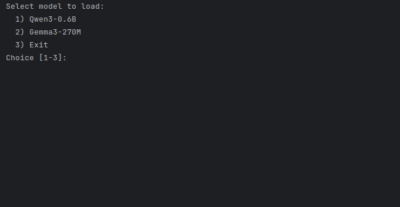

[](http://www.apache.org/licenses/LICENSE-2.0)
[](https://bell-sw.com/pages/downloads/)
[](https://maven.apache.org/)
[](http://search.maven.org/#artifactdetails|com.igormaznitsa|nano-vllm-java|1.4.0|jar)
[](https://www.arthursacresanimalsanctuary.org/donate)

# Nano-vLLM Java

A Java library that **runs a pretrained model on the CPU** and returns an answer. You add a Maven or Gradle dependency and call it from ordinary Java. There is no Python process, no CUDA, and no PyTorch.

Use it when a Java app needs a small local model: a short chat reply, a sentence vector, a transcript, a spoken WAV, a language label, or a choice with a probability. It does not train models. It loads files you already have and runs inference.

**1.4.0** is the release on Maven Central. This repository is **1.5.0-SNAPSHOT** and also includes Qwen3.5 text, typed decisions (Jev), and the checkers sample. The longer design tour (scheduler, attention, tensors, formats) is [`description.md`](description.md).

Ideas here were inspired by the Python [nano-vllm](https://github.com/GeeeekExplorer/nano-vllm) educational engine.

## What you can ask it to do

| You have | You get | Call |
|----------|---------|------|
| A question or a log snippet | A text reply | `llm.chatOnce(…)` or `llm.chat(…).send(…).answer()` |
| A sentence | A vector (for search) | `generate(text, EMBEDDING)` |
| A WAV clip | A transcript | `generate(sound, TEXT)` |
| A sentence | A WAV file | `generate(text, AUDIO)` |
| A sentence | Ranked labels (language id, and similar) | `generate(text, LABELS)` |
| A situation and a fixed list of options | The chosen option and a probability for each | `jev.decide(…)` (snapshot) |
| Your own notes on disk | A reply that can quote those notes | `llm.rag(…).ask(…)` |

One `LLM` serves one caller at a time. Share the loaded `LlmModel` across engines; give each thread its own `LLM`.

## Add it to an application

JDK **21+**. A small chat model (Gemma3-270M, Qwen3-0.6B) wants a few gigabytes of heap. Larger checkpoints want more. The in-repo demos expect about 16 GB.

**Maven**

```xml
<dependency>
  <groupId>com.igormaznitsa</groupId>
  <artifactId>nano-vllm-java</artifactId>
  <version>1.4.0</version>
</dependency>
```

**Gradle**

```gradle
implementation 'com.igormaznitsa:nano-vllm-java:1.4.0'
```

On the module path: `requires com.igormaznitsa.nanollvm;`.

Weights are not in this git tree. Download scripts and folder layout are in [`models/README.md`](models/README.md). A good first chat model with no Hugging Face gate is Qwen3-0.6B:

```bash
./models/download-qwen3-0.6b.sh
```

Gemma3-270M is smaller and needs you to accept the model license on Hugging Face first (`./models/download-gemma3-270m.sh`).

## Chat

Point `LlmModelFactory` at a local folder (`config.json`, tokenizer, `*.safetensors`) or at a single `.gguf` file, then build an `LLM`.

```java
import com.igormaznitsa.nanollvm.llm.LLM;
import com.igormaznitsa.nanollvm.models.LlmModel;
import com.igormaznitsa.nanollvm.models.LlmModelFactory;

import java.nio.file.Path;

Path modelDir = Path.of("/opt/models/Gemma3-270M");

try (LlmModel model = LlmModelFactory.make(modelDir);
     LLM llm = LLM.builder(model)
         .noSystemPrompt()   // Gemma chat path; Qwen can take .systemPrompt("…")
         .build()) {

  String reply = llm.chatOnce("""
      Read the log and reply in three short bullets: what failed, likely cause, one next check.
      Do not invent hosts or error codes that are not in the log.

      2026-08-07 22:14:08 ERROR payment-api - give up order=99102 after 3 timeouts upstream=billing-svc:8443
      """);
  System.out.println(reply);
}
```

The same program is `LogTriageHelloWorld` in this repo (default folder `models/Gemma3-270M`):

```bash
mvn -pl nano-vllm-java-samples -q exec:java \
  -Dexec.mainClass=com.igormaznitsa.nanollvm.samples.LogTriageHelloWorld
```

## Other calls

Each snippet loads a model the same way as chat, then asks for a different result. `generate` returns the concrete type for that job (`LlmOutText`, `LlmOutEmbedding`, `LlmOutSoundData`, `LlmOutLabels`).

**Sentence vector** — download with `./models/download-multilingual-e5-small.sh`.

```java
LlmOutEmbedding vector = llm.generate(
    LlmInText.of("query: hello world"), LlmModality.EMBEDDING);
```

**Speech to text** — mono PCM in `[-1, 1]`, or an uncompressed WAV. `./models/download-whisper-base.sh`.

```java
LlmOutText transcript = llm.generate(
    LlmInSound.ofWav(Files.readAllBytes(Path.of("clip.wav"))), LlmModality.TEXT);
```

**Text to speech** — PCM16 WAV bytes. `./models/download-piper-en-lessac-medium.sh`.

```java
Path voice = Path.of("models/piper-en-lessac-medium");
try (LlmModel model = LlmModelFactory.open(voice)
         .optionalData(LlmOptionalData.ESPEAK_DATA, voice.resolve("espeak-ng-data"))
         .make();
     LLM llm = LLM.builder(model).build()) {
  byte[] wav = llm.generate(LlmInText.of("Hello world"), LlmModality.AUDIO).wav();
}
```

**Language id** — `./models/download-fasttext-lid-176.sh`.

```java
LlmOutLabels labels = llm.generate(
    LlmInText.of("Bonjour, comment allez-vous ?"), LlmModality.LABELS);
System.out.println(labels.topLabel());
```

**A choice with probabilities** (this snapshot, any causal chat model). Nothing is parsed from the reply; the engine reads the next-token scores.

```java
try (LlmModel model = LlmModelFactory.make(Path.of("models/Gemma3-270M"));
     Jev jev = LLM.builder(model).toJev()) {
  JevDecision route = jev.decide(
      "My card was charged twice for one order.",
      JevQuestion.choice("Which team should handle this?",
          List.of("billing", "technical", "sales", "other")));
  System.out.println(route.answer());
}
```

**Notes beside the model.** UTF-8 `.txt` / `.md` files. The model still writes the answer; retrieval only puts passages into the prompt.

```java
PreparedRag notes = RagFactory.builder()
    .addFolders(Path.of("docs"))
    .add("hours", "Live chat is available 9–17 UTC.")
    .build();

String answer = llm.rag(notes).topK(4).ask("When is live chat open?");
```

## Samples in this repository

Run from the repository root after the matching download in [`models/README.md`](models/README.md). An optional first argument overrides the model path (`-Dexec.args=…`).

| Sample | What it shows | Default model |
|--------|----------------|---------------|
| `HelloWorld` | One hello, one reply | Gemma3-270M |
| `LogTriageHelloWorld` | Three bullets from a log excerpt | Gemma3-270M |
| `NextTokenHelloWorld` | Continue a seed | Tiny-LLM-ONNX |
| `EmbeddingsHelloWorld` | Sentence vector | multilingual-e5-small |
| `TranscribeHelloWorld` | WAV or a tone → text | whisper-base |
| `SynthesizeHelloWorld` | Text → `piper-hello.wav` | piper-en-lessac-medium |
| `VoiceReplyHelloWorld` | Transcribe, then chat, then speak | whisper + chat + piper |
| `LanguageIdHelloWorld` | Language label | fasttext lid.176 |
| `AdvisorRagHelloWorld` | Named advisors plus search over `rag/` | Gemma3-270M |
| `RagTunerHelloWorld` | Read a bundled EPUB, then ask about the play | Qwen3-0.6B |
| `JevHelloWorld` | Choice, yes/no, and a score (snapshot) | Gemma3-270M |
| `RussianCheckersHelloWorld` | Russian draughts in the terminal; you pick a colour (snapshot) | Jeff-Qwen3.5-0.8B |
| `Example` | Interactive menu: chat, search, Jev | first model on disk |
| `Bench` | Throughput smoke test | Qwen3-0.6B |

```bash
mvn -pl nano-vllm-java-samples -q exec:java \
  -Dexec.mainClass=com.igormaznitsa.nanollvm.samples.HelloWorld
```

Swap the class name for any row above. `Example` is the default main, so this is enough after a download:

```bash
mvn -pl nano-vllm-java-samples -q exec:java
```

`/exit` leaves. `/clear` drops the conversation and keeps the document index. `NO_COLOR=1` turns ANSI colors off.

Checkers: Enter selects White. A move is `a3 b4` or `A 3 B 4`. `q` quits. Download: `./models/download-jeff-qwen3.5-0.8b.sh`.



## What you can load

`LlmModelFactory.make(path)` accepts a Hugging Face folder, a `.gguf` file, or a fastText `*.bin` / `*.ftz`. This is a curated set of families.

| Family | Typical file | Job |
|--------|----------------|-----|
| Qwen3, Gemma3, Llama | Safetensors folder, or ONNX weights in that folder | Chat |
| Qwen3 | Also a `.gguf` file | Chat |
| Qwen3.5 text | Safetensors only (snapshot). The vision tower is skipped | Chat, and Jev |
| Gemma 4 text (QAT mobile) | Safetensors only | Chat |
| LFM2 | `.gguf` only | Chat |
| BERT (gte, E5, XLM-RoBERTa, …) | `.gguf` or ONNX | Embeddings |
| Whisper | Safetensors folder | Speech to text |
| Piper | `*.onnx` + `*.onnx.json` | Text to speech |
| fastText | `*.bin` or `*.ftz` | Labels |

If a folder has both safetensors and ONNX, safetensors is used. An unsupported file fails with `UnsupportedModelException` and the list of families this build knows.

## Limits

- **CPU, small models.** Answers are slower than a GPU server, and a 270M–0.8B model will miss facts, waffle, or invent a detail. Search over your notes can supply a passage; the model can still garble it.
- **Inference only.** The files do not change while you chat.
- **Text in, and the jobs in the table above.** No image or audio understanding beyond Whisper. No image generation. Qwen3.5 vision, LoRA adapters, mixture-of-experts, and Qwen3-Next are refused.
- **Whisper** reads uncompressed WAV or PCM. No MP3, no timestamps, no voice-activity detection.
- **Piper** returns one WAV per call. No streaming audio and no SSML.
- **GGUF chat** is Qwen3 and LFM2. **GGUF embeddings** are BERT. Other GGUF architectures are out.
- **ONNX** contributes weights to the Java engine. Quantized community exports and graphs that need ONNX Runtime are skipped.
- **Documents for search** are UTF-8 text. PDF and EPUB need a small extractor you register (`RagTunerHelloWorld` shows an EPUB).
- **One `LLM` at a time.** Do not call `generate` or chat on the same instance from two threads. `cancel()` from another thread is safe.

Format tables, quant types, and the engine internals are in [`description.md`](description.md), especially chapters **7–7g** and **19**.

## Build from source

JDK 21+ and Maven 3.8+, from the repository root:

```bash
mvn test
mvn package
```

The library jar is `nano-vllm-java/target/nano-vllm-java-1.5.0-SNAPSHOT.jar` (module `com.igormaznitsa.nanollvm`). Samples stay in `nano-vllm-java-samples` and are not published. Tests skip when a local checkpoint is missing.

## Further reading

| Doc | What is there |
|-----|----------------|
| [`description.md`](description.md) | How the engine works: attention, tensors, scheduler, formats, RAG, honest limits |
| [`models/README.md`](models/README.md) | Every download script and the folder it creates |
| [`CHANGELOG.md`](CHANGELOG.md) | What each release added |

## License

Apache License 2.0 — see [LICENSE](LICENSE).
