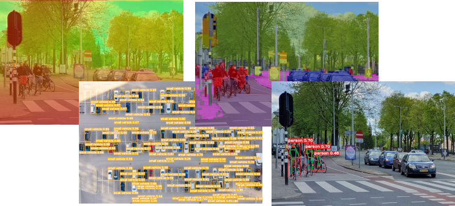
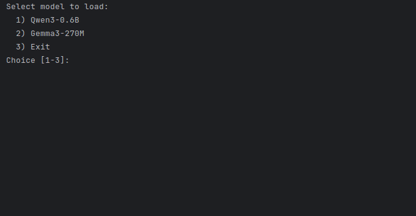
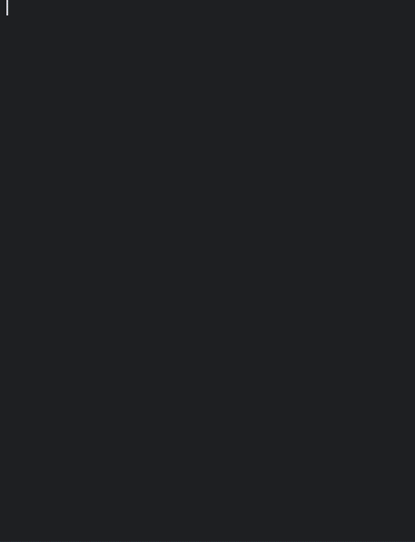

[](http://www.apache.org/licenses/LICENSE-2.0)
[](https://bell-sw.com/pages/downloads/)
[](https://maven.apache.org/)
[](http://search.maven.org/#artifactdetails|com.igormaznitsa|nano-vllm-java|1.4.0|jar)
[](https://www.arthursacresanimalsanctuary.org/donate)

# Nano-vLLM Java

A Java library that runs a pretrained model on the CPU and returns an answer. You add a Maven or Gradle dependency and call it from ordinary Java. The call stays in the JVM: no Python process, no CUDA, and no PyTorch.

It does not train models. It loads files you already have and runs inference.

**For** a Java application that needs a small local model: a short chat reply, a sentence vector, a transcript, a spoken WAV, a language label, or a choice with a probability.

**Supports** Qwen3, Qwen3.5 text, Gemma 3, Gemma 4 text, Llama, LFM2, BERT embeddings, Whisper, Piper, fastText, and YOLO26 images. The full list is [below](#supported-models).

**Attach** `com.igormaznitsa:nano-vllm-java:1.4.0` on JDK 21+. Coordinates and a first call are under [Add it to an application](#add-it-to-an-application).

**Try a sample** from this repository after one download. Qwen3-0.6B needs no Hugging Face gate:

```bash
./models/download-qwen3-0.6b.sh
mvn -pl nano-vllm-java-samples -q exec:java
```

That opens the interactive menu (chat, search, typed decisions). Every other sample, including weather and Russian checkers, is under [Run the samples](#run-the-samples).

**1.4.0** is the release on Maven Central. This repository is **1.5.0-SNAPSHOT** and also includes Qwen3.5 text, typed decisions (Jev), YOLO26 images, the checkers sample, and a weather sample. The longer design tour (scheduler, attention, tensors, formats) is [`description.md`](description.md).

Ideas here were inspired by the Python [nano-vllm](https://github.com/GeeeekExplorer/nano-vllm) educational engine.

## Contents

- [What it is for](#what-it-is-for)
- [Supported models](#supported-models)
- [Add it to an application](#add-it-to-an-application)
- [Chat](#chat)
- [Tools](#tools)
- [Jev](#jev)
- [Images](#images)
- [Run the samples](#run-the-samples)
- [Other calls](#other-calls)
- [Threads](#threads)
- [Limits](#limits)
- [Build from source](#build-from-source)

## What it is for

| You have | You get | Call |
|----------|---------|------|
| A question or a log snippet | A text reply | `llm.chatOnce(…)` or `llm.chat(…).send(…).answer()` |
| A sentence | A vector (for search) | `generate(text, EMBEDDING)` |
| A WAV clip | A transcript | `generate(sound, TEXT)` |
| A sentence | A WAV file | `generate(text, AUDIO)` |
| A sentence | Ranked labels (language id, and similar) | `generate(text, LABELS)` |
| A picture | Object boxes, a mask, pose points, a map, depth, or image labels | `model.generate(new LlmInImage(…), IMAGE)` (snapshot) |
| A situation and a fixed list of options | The chosen option and a probability for each | `jev.decide(…)` (snapshot) |
| Your own notes on disk | A reply that can quote those notes | `llm.rag(…).ask(…)` |
| A question your Java function can answer | A reply after that function runs | `builder.tool(ModelTool.of(…))`, then `chat().send(…)` (snapshot) |

One `LLM` runs one call at a time. Share the loaded `LlmModel` across engines when calls should overlap. The rules are in [Threads](#threads).

## Supported models

`LlmModelFactory.make(path)` accepts a Hugging Face folder, a `.gguf` file, a YOLO26 `*.onnx`, or a fastText `*.bin` / `*.ftz`. This is a curated set of families.

| Family | Typical file | Job |
|--------|----------------|-----|
| Qwen3, Gemma 3, Llama | Safetensors folder, or ONNX weights in that folder | Chat |
| Qwen3 | Also a `.gguf` file | Chat |
| Qwen3.5 text | Safetensors only (snapshot). The vision tower is skipped | Chat, and Jev |
| Gemma 4 text (QAT mobile) | Safetensors only | Chat |
| LFM2 | `.gguf` only | Chat |
| BERT (gte, E5, XLM-RoBERTa, …) | `.gguf` or ONNX | Embeddings |
| Whisper | Safetensors folder | Speech to text |
| Piper | `*.onnx` + `*.onnx.json` | Text to speech |
| fastText | `*.bin` or `*.ftz` | Labels |
| YOLO26 (nano through extra-large) | fused `*.onnx`, `nms=False`, 640 | Detect, segment, pose, oriented boxes, semantic map, depth, or image labels |

If a folder has both safetensors and ONNX, safetensors is used. An unsupported file fails with `UnsupportedModelException` and the list of families this build knows.

Download scripts and the folder each one creates are in [`models/README.md`](models/README.md). A good first chat model with no Hugging Face gate is Qwen3-0.6B (`./models/download-qwen3-0.6b.sh`). Gemma3-270M is smaller and needs you to accept the model license on Hugging Face first (`./models/download-gemma3-270m.sh`).

## Add it to an application

JDK **21+**. A small chat model (Gemma3-270M, Qwen3-0.6B) wants a few gigabytes of heap. Larger checkpoints want more. The in-repo demos expect about 16 GB.

**Maven**

```xml
<dependency>
  <groupId>com.igormaznitsa</groupId>
  <artifactId>nano-vllm-java</artifactId>
  <version>1.4.0</version>
</dependency>
```

**Gradle**

```gradle
implementation 'com.igormaznitsa:nano-vllm-java:1.4.0'
```

On the module path: `requires com.igormaznitsa.nanollvm;`.

Weights are not in the published jar and not in this git tree. Point `LlmModelFactory` at a folder you downloaded (`config.json`, tokenizer, `*.safetensors`) or at a single `.gguf` file.

## Chat

```java
import com.igormaznitsa.nanollvm.llm.LLM;
import com.igormaznitsa.nanollvm.models.LlmModel;
import com.igormaznitsa.nanollvm.models.LlmModelFactory;

import java.nio.file.Path;

Path modelDir = Path.of("/opt/models/Gemma3-270M");

try (LlmModel model = LlmModelFactory.make(modelDir);
     LLM llm = LLM.builder(model)
         .noSystemPrompt()   // Gemma chat path; Qwen can take .systemPrompt("…")
         .build()) {

  String reply = llm.chatOnce("""
      Read the log and reply in three short bullets: what failed, likely cause, one next check.
      Do not invent hosts or error codes that are not in the log.

      2026-08-07 22:14:08 ERROR payment-api - give up order=99102 after 3 timeouts upstream=billing-svc:8443
      """);
  System.out.println(reply);
}
```

The same program is `LogTriageHelloWorld` in this repo (default folder `models/Gemma3-270M`):

```bash
mvn -pl nano-vllm-java-samples -q exec:java \
  -Dexec.mainClass=com.igormaznitsa.nanollvm.samples.LogTriageHelloWorld
```

## Tools

This snapshot. A chat turn can call a Java function you register on the engine. The model writes the call in that checkpoint's own tool format. The engine runs the function, sends the returned text back, and continues the reply. `chat` and `chatOnce` do this. Raw `generate` does not.

Qwen3, Qwen3.5, LFM2, and Gemma 4 are accepted. Gemma 3 and Llama fail at `build()` when a tool is registered.

```java
import com.igormaznitsa.nanollvm.llm.LLM;
import com.igormaznitsa.nanollvm.llm.ModelTool;
import com.igormaznitsa.nanollvm.models.LlmModel;
import com.igormaznitsa.nanollvm.models.LlmModelFactory;

import java.nio.file.Path;

ModelTool osName = ModelTool.of(
    "os_name",
    "Operating system name of this machine.",
    "{\"type\":\"object\",\"properties\":{}}",
    arguments -> System.getProperty("os.name"));

Path modelDir = Path.of("/opt/models/Qwen3-0.6B");

try (LlmModel model = LlmModelFactory.make(modelDir);
     LLM llm = LLM.builder(model)
         .tool(osName)
         .build()) {

  String reply = llm.chatOnce("What operating system is this? Call os_name.");
  System.out.println(reply);
}
```

The function receives a JSON object (`{}` when the call has no arguments) and returns text. The third argument is a JSON Schema object for those arguments. A name matches `[A-Za-z_][A-Za-z0-9_]*`. A space inside the name the model wrote is ignored, so `os_ name` still matches `os_name`. One user message runs at most the cap from `LLM.Builder.maxToolExecutions` (four when omitted). The function runs on the chat thread. A thrown exception goes back to the model as `error: …` and the turn continues.

`ToolsHelloWorld` registers `os_name` and `list_files`, then asks Qwen3-0.6B for each in its own turn. One question that names both makes this checkpoint call only one of them.

```bash
mvn -pl nano-vllm-java-samples -q exec:java \
  -Dexec.mainClass=com.igormaznitsa.nanollvm.samples.ToolsHelloWorld
```

## Jev

This snapshot. A decision is not a written sentence. You give a state and a typed question — a choice, a yes/no, or a score — and the engine reads the next-token probability of a few labels (`A` / `B`, `Yes` / `No`, or `1` / `2`). The answer is the option with the highest probability. Nothing is parsed from generated text, and nothing is trained.

There is one call, `LLM.builder(model).toJev()`, for both kinds of checkpoint below. Embeddings, Whisper, Piper, and fastText are refused. `Jev.close()` closes the engine and leaves the model open, so the same folder can still chat through `LLM.builder(model).build()`.

The default readout is `L0`. A choice is read once per option, a yes/no is read as both phrasings, and those probabilities are averaged. After eight states of the same question on that `Jev`, a label prior from those states is applied. `jevLevel(JevLevel.RAW)` is one prefill in the order you passed. `decision.require(JevLevel.L0)` throws when the read was `RAW`.

### A chat model

Any causal chat checkpoint. Gemma3-270M is the small one. Qwen3, Qwen3.5, Llama, LFM2, and Gemma 4 work the same way.

```java
import com.igormaznitsa.nanollvm.jev.Jev;
import com.igormaznitsa.nanollvm.jev.JevDecision;
import com.igormaznitsa.nanollvm.jev.JevQuestion;
import com.igormaznitsa.nanollvm.llm.LLM;
import com.igormaznitsa.nanollvm.models.LlmModel;
import com.igormaznitsa.nanollvm.models.LlmModelFactory;

import java.nio.file.Path;
import java.util.List;

try (LlmModel model = LlmModelFactory.make(Path.of("models/Gemma3-270M"));
     Jev jev = LLM.builder(model).toJev()) {

  JevDecision route = jev.decide(
      "My card was charged twice for one order.",
      JevQuestion.choice("Which team should handle this?",
          List.of("billing", "technical", "sales", "other")));
  System.out.println(route.answer() + " " + route.probability("billing"));

  JevDecision refund = jev.decide(
      "I want my money back for order 441.",
      JevQuestion.yesNo("Does this message ask for a refund?"));
  System.out.println(refund.answer());

  JevDecision urgency = jev.decide(
      "The payment page returns 500 and the customer cannot check out.",
      JevQuestion.score("How urgent is the customer's request?",
          List.of("low", "medium", "high")));
  System.out.println(urgency.score().getAsDouble());
}
```

`JevHelloWorld` runs this tour: one choice at L0 and at RAW, a yes/no, a score, then eight states until the label prior turns on.

```bash
mvn -pl nano-vllm-java-samples -q exec:java \
  -Dexec.mainClass=com.igormaznitsa.nanollvm.samples.JevHelloWorld
```

### Jeff

Jeff-Qwen3.5-0.8B is a Qwen3.5 fine-tune aimed at decisions. The download skips the vision files and the separate readout head. There is no second API for that head. `toJev()` reads the causal next-token scores, the same way it does for Gemma or Qwen3.

```java
import com.igormaznitsa.nanollvm.jev.JevLevel;

try (LlmModel model = LlmModelFactory.make(Path.of("models/Jeff-Qwen3.5-0.8B"));
     Jev jev = LLM.builder(model).jevLevel(JevLevel.RAW).toJev()) {

  JevDecision route = jev.decide(
      "My card was charged twice for one order.",
      JevQuestion.choice("Which team should handle this?",
          List.of("billing", "technical", "sales", "other")));
  System.out.println(route.answer());
}
```

Download: `./models/download-jeff-qwen3.5-0.8b.sh`. Russian checkers uses this checkpoint at `RAW`, one prefill per move, because a turn can have many legal moves and each L0 rotation would be another full read.

## Images

This snapshot. A picture goes in as packed pixels and the file decides the job: objects, a mask, pose points, oriented boxes, a semantic map, depth, or image labels. Chat is unchanged. The library does not use `java.desktop`.



*Depth tints the street from red (near) to green (far). Semantic paints each surface. Oriented boxes mark the parking lot. Detect writes the person scores on the crossing.*

The call below is the same for `yolo26n.onnx` through `yolo26x.onnx`. The loader reads the first convolution: 16 channels is nano, 32 is small, 64 is medium or large, and 96 is extra-large. Medium and large share that 64-channel stem; a second copy of the first block selects large. Medium and larger use a `C3k` inner block and a channel cap of 512. Large and extra-large also repeat those blocks. The file is a fused end-to-end export (`nms=False`, image size 640). P2, P6, YOLOE, and a `.pt` file are refused.

`open(path)` detects the kind and calls `open(path, LlmModelType)`. A renamed file such as `lalala.onnx` has nothing to detect, so pass the kind. A YOLO constant selects the head. The scale is still read from the weights, and a GGUF or Hugging Face file still reads its architecture from the file.

```java
import com.igormaznitsa.nanollvm.models.LlmModelType;

try (LlmModel model = LlmModelFactory.open(Path.of("lalala.onnx"), LlmModelType.YOLO_DETECT).make()) {
  LlmOutObjects found = model.generate(
      new LlmInImage(new ArgbImage(width, height, pixels)), LlmModality.IMAGE);
}
```

```java
import com.igormaznitsa.nanollvm.models.ArgbImage;
import com.igormaznitsa.nanollvm.models.Box;
import com.igormaznitsa.nanollvm.models.LlmInImage;
import com.igormaznitsa.nanollvm.models.LlmModality;
import com.igormaznitsa.nanollvm.models.LlmModel;
import com.igormaznitsa.nanollvm.models.LlmModelFactory;
import com.igormaznitsa.nanollvm.models.LlmOutObjects;
import com.igormaznitsa.nanollvm.models.VisionHit;

import java.nio.file.Path;
import java.util.List;

int[] pixels = /* row-major 0xAARRGGBB, index y * width + x */;

try (LlmModel model = LlmModelFactory.make(
    Path.of("models/YOLO26n/detect/yolo26n.onnx"))) {

  LlmOutObjects found = model.generate(
      LlmInImage.builder(new ArgbImage(width, height, pixels))
          .addClass("car", 0.4f)
          .addClass("bicycle", 0.3f)
          .build(),
      LlmModality.IMAGE);

  List<String> names = model.classNames();
  for (VisionHit hit : found.objects()) {
    Box box = (Box) hit.shape();
    System.out.println(hit.classId() + " " + names.get(hit.classId()) + " " + hit.probability()
        + " @ " + box.left() + "," + box.top());
  }
}
```

The picture is letterboxed to a square whose edge is a multiple of 32. Omit the size and it stays 640. Boxes, mask outlines, rotated corners, and pose points come back in the original picture's pixels. A detection ranks at most `maxDetections` objects (300 when omitted) whose score is at least `minProbability` (`0.25` when omitted). `addClass("car", 0.4f)` and `addClass("bicycle", 0.3f)` on the builder use those floors for those class names and leave every other class on `minProbability`. The name is a line from `classes.txt`, matched exactly. An unknown name is rejected. Pose drops a joint below `keypointMinProbability` (`0.5` when omitted). Classification returns at most `maxLabels` names (5 when omitted). `LlmInImage.builder(raster)` sets those by name. `new LlmInImage(raster, 0.4f)` keeps scores of `0.4` and above and leaves the other knobs at their defaults. A knob that does not apply to the loaded head is rejected when it is not the default. The class count and the pose width are read from the file. `YoloStreetHelloWorld.fromBufferedImage` copies a `BufferedImage` into the packed layout, and `toBufferedImage` copies a result raster back.

| File | `generate` result |
|------|-------------------|
| `yolo26n.onnx` or `yolo26s.onnx` | `LlmOutObjects` — a `Box` per object |
| `…-seg.onnx`, `…-obb.onnx` | `LlmOutObjects` — a polygon (mask outline, or four rotated corners) |
| `…-pose.onnx` | `LlmOutObjects` — a box plus keypoints |
| `…-sem.onnx`, `…-depth.onnx` | `LlmOutImage` — class indexes, or grayscale depth with the min and max in meters |
| `…-cls.onnx` | `LlmOutLabels` via `generate(image, LABELS)` |

Each object carries the class index from the head. `classNames()` is `classes.txt` in the same folder as the ONNX file, one name per line, in that index order. Use the index as it is, or read the name from that list. The picture read does not look the name up. The library does not guess a dataset. Depth has no names. Those lists are already in `models/YOLO26n/<task>/`. Replace `classes.txt` when a head was trained on another list.

```bash
./models/download-yolo26n.sh
mvn -pl nano-vllm-java-samples -q exec:java \
  -Dexec.mainClass=com.igormaznitsa.nanollvm.samples.YoloStreetHelloWorld
```

With no argument the sample asks for a head. `detect`, `seg`, `sem`, `pose`, `obb`, `depth`, or `cls` skips the menu. Detect, segment, semantic, pose, depth, and classification use a street photo. Semantic paints each Cityscapes surface in its own color, half transparent. Depth paints that photo from red (near) to green (far), half transparent, and prints the nearest and farthest meters. Classification writes the top five ImageNet labels on the photo. Oriented boxes use an overhead parking lot. The marked picture is `yolo-street-<head>.png`. Pose joins the body points with green lines. Segmentation fills each outline at half strength. A box covering at least two percent of the picture is kept down to a score of 0.01. The download script fetches nano. Point the same call at a `yolo26s`, `yolo26m`, `yolo26l`, or `yolo26x` ONNX you exported the same way.

## Run the samples

Run from the repository root after the matching download in [`models/README.md`](models/README.md). An optional first argument overrides the model path (`-Dexec.args=…`).

Any row in the table:

```bash
mvn -pl nano-vllm-java-samples -q exec:java \
  -Dexec.mainClass=com.igormaznitsa.nanollvm.samples.HelloWorld
```

Swap the class name. `Example` is the default main, so this is enough after a download:

```bash
mvn -pl nano-vllm-java-samples -q exec:java
```

| Sample | What it shows | Default model |
|--------|----------------|---------------|
| `HelloWorld` | One hello, one reply | Gemma3-270M |
| `ToolsHelloWorld` | OS name and a directory listing via tools | Qwen3-0.6B |
| `LogTriageHelloWorld` | Three bullets from a log excerpt | Gemma3-270M |
| `NextTokenHelloWorld` | Continue a seed | Tiny-LLM-ONNX |
| `EmbeddingsHelloWorld` | Sentence vector | multilingual-e5-small |
| `TranscribeHelloWorld` | WAV or a tone → text | whisper-base |
| `SynthesizeHelloWorld` | Text → `piper-hello.wav` | piper-en-lessac-medium |
| `VoiceReplyHelloWorld` | Transcribe, then chat, then speak | whisper + chat + piper |
| `LanguageIdHelloWorld` | Language label | fasttext lid.176 |
| `YoloStreetHelloWorld` | People, bicycles, and cars marked on a street photo, with scores. Semantic paints each surface. Depth tints that street from red (near) to green (far). Classification writes the top labels | YOLO26n detect, seg, sem, pose, obb, depth, or cls |
| `AdvisorRagHelloWorld` | Named advisors plus search over `rag/` | Gemma3-270M |
| `RagTunerHelloWorld` | Read a bundled EPUB, then ask about the play | Qwen3-0.6B |
| `JevHelloWorld` | Choice, yes/no, and a score (snapshot) | Gemma3-270M |
| `RussianCheckersHelloWorld` | Russian draughts in the terminal; you pick a colour (snapshot) | Jeff-Qwen3.5-0.8B |
| `Example` | Interactive menu: chat, search, Jev | first model on disk |
| `Bench` | Throughput smoke test | Qwen3-0.6B |

### Interactive menu

`Example` lists the models it finds, then chats. `/exit` leaves. `/clear` drops the conversation and keeps the document index. `NO_COLOR=1` turns ANSI colors off.



*Pick a model, then ask. This run loads Gemma 3 and asks about the Grimm brothers.*

### Weather

`nano-vllm-java-weather-sample` is a separate module. Qwen3-0.6B asks where this computer is, then what the weather is there. Piper says it is looking for the location before that question. When the coordinates arrive it prints a 64-column world map, Kavrayskiy VII over the Natural Earth coastline, with that position marked. Piper then says it is getting the weather in that city. It prints the temperature and the sky, and Piper speaks that line on the default audio output. Each spoken line finishes before the next step starts. The log gives the wall-clock time of each step.

If the chat model or a Piper voice is missing, the sample stops before loading and prints the download command for each one. The two questions stay separate because this checkpoint calls one tool when a question names both. Gemma 3 has no tool-call tokens. Qwen3.5, LFM2, and Gemma 4 can replace it via the first argument.

The place is this computer's public network address (ipwho.is, then geojs, then ipapi.co). The weather is [Open-Meteo](https://open-meteo.com/) (CC BY 4.0). Neither needs an API key.

```bash
./models/download-qwen3-0.6b.sh
./models/download-piper-en-lessac-medium.sh
mvn -pl nano-vllm-java-weather-sample -am -q exec:java
```

Speech is English, with the Lessac voice. Windows download scripts are in [`models/README.md`](models/README.md).


*Qwen3 locates this computer, prints the map and the forecast, then Piper speaks the line.*

### Russian checkers

You pick a colour. Enter selects White. Jeff (Qwen3.5) plays the other colour. A move is `a3 b4` or `A 3 B 4`. `q` quits.

```bash
./models/download-jeff-qwen3.5-0.8b.sh
mvn -pl nano-vllm-java-samples -q exec:java \
  -Dexec.mainClass=com.igormaznitsa.nanollvm.samples.RussianCheckersHelloWorld
```



*You play White. Jeff answers with Qwen3.5. The game ends when your king is taken.*

## Other calls

Each snippet loads a model the same way as chat, then asks for a different result. `generate` returns the concrete type for that job (`LlmOutText`, `LlmOutEmbedding`, `LlmOutSoundData`, `LlmOutLabels`).

**Sentence vector** — download with `./models/download-multilingual-e5-small.sh`.

```java
LlmOutEmbedding vector = llm.generate(
    LlmInText.of("query: hello world"), LlmModality.EMBEDDING);
```

**Speech to text** — mono PCM in `[-1, 1]`, or an uncompressed WAV. `./models/download-whisper-base.sh`.

```java
LlmOutText transcript = llm.generate(
    LlmInSound.ofWav(Files.readAllBytes(Path.of("clip.wav"))), LlmModality.TEXT);
```

**Text to speech** — PCM16 WAV bytes. `./models/download-piper-en-lessac-medium.sh`.

```java
Path voice = Path.of("models/piper-en-lessac-medium");
try (LlmModel model = LlmModelFactory.open(voice)
         .optionalData(LlmOptionalData.ESPEAK_DATA, voice.resolve("espeak-ng-data"))
         .make();
     LLM llm = LLM.builder(model).build()) {
  byte[] wav = llm.generate(LlmInText.of("Hello world"), LlmModality.AUDIO).wav();
}
```

**Language id** — `./models/download-fasttext-lid-176.sh`.

```java
LlmOutLabels labels = llm.generate(
    LlmInText.of("Bonjour, comment allez-vous ?"), LlmModality.LABELS);
System.out.println(labels.topLabel());
```

**Images** — [Images](#images). YOLO26 nano through extra-large. `./models/download-yolo26n.sh`.

**A choice with probabilities** — [Jev](#jev) (this snapshot). A chat checkpoint and the Jeff checkpoint use the same `toJev()` call.

**Notes beside the model.** UTF-8 `.txt` / `.md` files. The model still writes the answer; retrieval only puts passages into the prompt.

```java
PreparedRag notes = RagFactory.builder()
    .addFolders(Path.of("docs"))
    .add("hours", "Live chat is available 9–17 UTC.")
    .build();

String answer = llm.rag(notes).topK(4).ask("When is live chat open?");
```

## Threads

Weights are shared. A conversation is not. Load the model once, then give each concurrent caller its own engine.

| Object | Across threads |
|--------|----------------|
| `LlmModel` | Yes. Weights, tokenizer, and load options stay frozen. Many `LLM` engines bind the same model. |
| `PreparedRag`, a `RagIndex` | Yes. `retrieve` from many threads. A dense index keeps the embedding model open and embeds each query on its own. |
| `LLM` | One call at a time. A second `generate`, chat, RAG ask, or `jev.decide` waits, then runs, and returns its own result. |
| `ChatSession`, `RagSession`, `Jev` | No. One thread each. History, and a Jev level-0 prior, live on that object. |

Two chats at once are two engines on one model. Each engine has its own KV cache, so two engines use about twice the cache RAM.

```java
Path modelDir = Path.of("/opt/models/Qwen3-0.6B");

try (LlmModel model = LlmModelFactory.make(modelDir);
     LLM first = LLM.builder(model).build();
     LLM second = LLM.builder(model).build()) {

  ChatSession left = first.chat();
  ChatSession right = second.chat();
  // left.send(...) and right.send(...) may run together
}
```

Close every `LLM` before `model.close()`. Closing an engine does not unload the weights. `Jev.close()` closes its engine and leaves the model open.

One shared `LLM` is a queue. Several `ChatSession`s may sit on it; their turns run one after another. A tool-calling turn lets the next waiter in between model calls. Each waiter still gets its own reply.

`cancel()` belongs to the engine, not to the caller. It aborts whoever is generating on that `LLM` (`GenerationCancelledException`). A cancel that arrives before a call has started is dropped when the call starts. `close()` from any thread cancels the in-flight call; a later call throws `IllegalStateException`.

A token callback runs inside the call that is still generating. Do not call `generate`, chat, or RAG from that callback.

Pass `Builder.random` only to one engine. Two concurrent engines need two `Random` instances.

With `cpuThreads` above 1, engines share a process-wide pool named `nanollvm-matmul-*` unless you change it. `matmulExecutor` uses a pool you own and shut down. `dedicatedMatmulPool` uses a pool that closes with that engine. `disableMultiCpu` keeps the work on the calling thread.

## Limits

- **CPU, small models.** Answers are slower than a GPU server, and a 270M–0.8B model will miss facts, waffle, or invent a detail. Search over your notes can supply a passage; the model can still garble it.
- **Inference only.** The files do not change while you chat.
- **Text in, and the jobs in the table above.** YOLO26 nano through extra-large reads a picture (objects, a map, depth, or labels). P2, P6, and YOLOE are refused. No other image understanding, and no image generation. Qwen3.5 vision, LoRA adapters, mixture-of-experts, and Qwen3-Next are refused.
- **Whisper** reads uncompressed WAV or PCM. No MP3, no timestamps, no voice-activity detection.
- **Piper** returns one WAV per call. No streaming audio and no SSML.
- **GGUF chat** is Qwen3 and LFM2. **GGUF embeddings** are BERT. Other GGUF architectures are out.
- **ONNX** contributes weights to the Java engine. Quantized community exports and graphs that need ONNX Runtime are skipped.
- **Documents for search** are UTF-8 text. PDF and EPUB need a small extractor you register (`RagTunerHelloWorld` shows an EPUB).
- **One call at a time per `LLM`.** Overlap needs one engine per caller on a shared `LlmModel`. See [Threads](#threads).

Format tables, quant types, and the engine internals are in [`description.md`](description.md), especially chapters **7–7g** and **19**.

## Build from source

JDK 21+ and Maven 3.8+, from the repository root:

```bash
mvn test
mvn package
```

The library jar is `nano-vllm-java/target/nano-vllm-java-1.5.0-SNAPSHOT.jar` (module `com.igormaznitsa.nanollvm`). Samples stay in `nano-vllm-java-samples` and are not published. Tests skip when a local checkpoint is missing.

## Further reading

| Doc | What is there |
|-----|----------------|
| [`description.md`](description.md) | How the engine works: attention, tensors, scheduler, formats, RAG, honest limits |
| [`models/README.md`](models/README.md) | Every download script and the folder it creates |
| [`CHANGELOG.md`](CHANGELOG.md) | What each release added |

## License

Apache License 2.0 — see [LICENSE](LICENSE).
